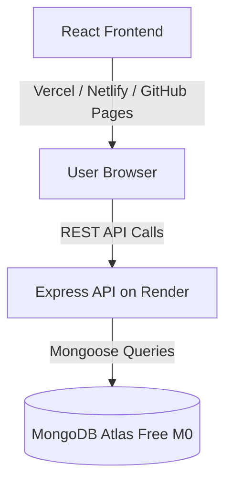

# 🚀 End-to-End Deployment Guide

This guide walks you through deploying the **Support Ticketing Tool** across free-tier cloud platforms.



---

## 🗄️ Step 1: Database Setup (MongoDB Atlas)

1. **Sign up or Log in:** Visit [mongodb.com/cloud/atlas](https://www.mongodb.com/cloud/atlas) and log in.
2. **Create a Free Cluster:**
   - Choose **M0 Free Tier** (Shared).
   - Select your preferred cloud provider and closest region (e.g., AWS / Mumbai or Frankfurt).
3. **Configure Database Access:**
   - Navigate to **Security** ➔ **Database Access**.
   - Click **Add New Database User**.
   - Authentication Method: **Password**.
   - Create a username (e.g., `ticketing_admin`) and secure password.
   - Built-in Role: **Read and write to any database**.
4. **Configure Network Access:**
   - Navigate to **Security** ➔ **Network Access**.
   - Click **Add IP Address**.
   - Click **Allow Access from Anywhere** (`0.0.0.0/0`) so that Render can connect.
5. **Get your Connection URI:**
   - Go to **Deployments** ➔ **Database** ➔ click **Connect**.
   - Choose **Drivers** (Node.js).
   - Copy the connection string. It looks like:
     ```
     mongodb+srv://ticketing_admin:<password>@cluster0.abcde.mongodb.net/ticketing_db?retryWrites=true&w=majority
     ```
   - Replace `<password>` with your database user password.

---

## ⚙️ Step 2: Backend API Deployment (Render)

1. **Sign in to Render:** Go to [render.com](https://render.com) and log in with your GitHub account.
2. **Create a Web Service:**
   - Click **New +** ➔ **Web Service**.
   - Select your GitHub repository: `devchahar-byte/support-ticketing-tool`.
3. **Configure Service Settings:**
   - **Name:** `support-ticketing-api`
   - **Language:** `Node`
   - **Branch:** `main`
   - **Root Directory:** `backend`
   - **Build Command:** `npm install`
   - **Start Command:** `npm start`
   - **Instance Type:** `Free`
4. **Set Environment Variables:**
   Click **Add Environment Variable** and add:
   | Key | Value |
   | :--- | :--- |
   | `NODE_ENV` | `production` |
   | `PORT` | `5000` |
   | `MONGO_URI` | *Your MongoDB Atlas connection string from Step 1* |
   | `FRONTEND_URL` | `*` *(or your Vercel URL once deployed)* |
5. **Deploy:** Click **Create Web Service**.
   - Render will build and deploy your API. Once deployed, note down your backend URL (e.g., `https://support-ticketing-api.onrender.com`).
   - Test it by visiting `https://support-ticketing-api.onrender.com/api/health`.

---

## 🎨 Step 3: Frontend Deployment (Vercel or Netlify)

### Option A: Vercel (Recommended)
1. **Sign in to Vercel:** Go to [vercel.com](https://vercel.com) and log in with GitHub.
2. **Add New Project:** Click **Add New...** ➔ **Project**.
3. **Import Repository:** Select `devchahar-byte/support-ticketing-tool`.
4. **Configure Build Settings:**
   - **Framework Preset:** `Vite`
   - **Root Directory:** Click *Edit* and select **`frontend`**.
   - Build Command: `npm run build`
   - Output Directory: `dist`
5. **Add Environment Variable:**
   | Key | Value |
   | :--- | :--- |
   | `VITE_API_URL` | `https://support-ticketing-api.onrender.com/api` *(Your Render backend URL)* |
6. **Deploy:** Click **Deploy**. Your app will be live at `https://support-ticketing-tool.vercel.app` in seconds!

---

### Option B: Netlify
1. Go to [netlify.com](https://www.netlify.com) and sign in.
2. Click **Add new site** ➔ **Import an existing project** ➔ Select GitHub.
3. Base directory: `frontend`
4. Build command: `npm run build`
5. Publish directory: `frontend/dist`
6. Under **Environment variables**, add:
   - `VITE_API_URL` = `https://support-ticketing-api.onrender.com/api`
7. Click **Deploy site**.

---

### Option C: GitHub Pages (Already Pre-Configured!)
Your frontend is also deployed to GitHub Pages:
**[https://devchahar-byte.github.io/support-ticketing-tool/](https://devchahar-byte.github.io/support-ticketing-tool/)**

---

## ✅ Step 4: Verification Checklist

Once both services are deployed, verify the complete loop:
1. **Health Check:** Open `https://your-api.onrender.com/api/health`. Expect:
   ```json
   { "status": "OK", "databaseConnected": true, "storageMode": "MongoDB" }
   ```
2. **Create Ticket:** In the frontend, click **+ New Ticket**, fill in the fields, and submit. Check that the new ticket appears with a success toast.
3. **Update Status/Priority:** Use the dropdown on the card to change status from `OPEN` to `IN_PROGRESS`. Verify immediate update.
4. **View Details & Reply:** Open the ticket details, write a reply in the discussion thread, and verify that the conversation persists.
5. **Delete Ticket:** Delete a test ticket and confirm it is removed from the dashboard.
