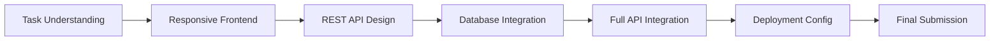

# 🎫 SupportFlow — Support Ticketing Tool

A complete, full-stack **Support Ticketing Tool** built as an internship capstone project. Designed with modern architecture, responsive UI, clean folder structure, robust REST API, MongoDB database integration, and automated testing.

[](https://github.com/devchahar-byte/support-ticketing-tool)
[](https://nodejs.org)
[](https://react.dev)
[](https://expressjs.com)
[](https://www.mongodb.com)
[](https://tailwindcss.com)

---

## 📑 Table of Contents
- [Development Flow & Internship Milestones](#-development-flow--internship-milestones)
- [Project Architecture & Structure](#-project-architecture--structure)
- [Technology Stack](#-technology-stack)
- [Key Features](#-key-features)
- [Getting Started Locally](#-getting-started-locally)
- [REST API Reference](#-rest-api-reference)
- [Postman & API Testing](#-postman--api-testing)
- [Database Schema](#-database-schema)
- [Deployment Guide](#-deployment-guide)
- [Evaluation & Review Checklist](#-evaluation--review-checklist)

---

## 🚀 Development Flow & Internship Milestones

The project was executed following the specified internship development lifecycle:



1. **Task Understanding:** Detailed requirements analysis, ticket lifecycle state machine (`Open` ➔ `In Progress` ➔ `Resolved` ➔ `Closed`), user roles (`Customer`, `Support Agent`, `Admin`), and priority classification (`Low`, `Medium`, `High`, `Urgent`).
2. **Responsive Frontend:** Engineered reusable components in React.js with Tailwind CSS, offering both Grid Card view and Data Table view, intuitive filtering, and responsive mobile/tablet navigation.
3. **REST API:** Built Express.js backend endpoints supporting full CRUD operations, live keyword search across multiple fields, sorting, pagination, and real-time dashboard analytics.
4. **Database Integration:** Integrated MongoDB using Mongoose with schema validation, indexes, and an automated database seeder. (Includes a zero-configuration fallback store for test environments without a running local MongoDB daemon).
5. **API Integration:** Connected React to Express via centralized service layer (`api.js`) with error handling, live health monitoring badge, and notification toasts.
6. **Deployment:** Configured deployment manifests (`vercel.json` for frontend, `render.yaml` for backend) and `.env.example` templates.
7. **Final Submission:** Verified with automated unit tests, clean git history, and complete Postman collection.

---

## 📂 Project Architecture & Structure

The repository maintains strict separation of frontend and backend concerns:

```
support-ticketing-tool/
├── backend/                              # Node.js + Express REST API
│   ├── postman/                          # Ready-to-import Postman collection
│   │   └── Support_Ticketing_Tool_API.postman_collection.json
│   ├── src/
│   │   ├── config/                       # Database configuration
│   │   │   └── db.js                     # MongoDB connection & fallback handler
│   │   ├── controllers/                  # Route business logic
│   │   │   └── ticketController.js       # CRUD, filtering, stats, replies
│   │   ├── middleware/                   # Express middleware
│   │   │   └── errorHandler.js           # Centralized JSON error handler
│   │   ├── models/                       # Mongoose data models
│   │   │   └── Ticket.js                 # Ticket & Response Schema
│   │   ├── routes/                       # Express route definitions
│   │   │   └── ticketRoutes.js
│   │   ├── seed.js                       # Database seeder with sample tickets
│   │   └── server.js                     # Server entry point & CORS
│   ├── test/                             # Automated test suite
│   │   └── api.test.js
│   ├── .env.example
│   └── package.json
│
├── frontend/                             # React.js Single Page Application
│   ├── src/
│   │   ├── components/                   # Modular, reusable UI components
│   │   │   ├── Navbar.jsx                # Header, API status badge & quick actions
│   │   │   ├── StatsCards.jsx            # KPI metric cards (Total, Open, etc.)
│   │   │   ├── FilterBar.jsx             # Live search, filters, and view toggles
│   │   │   ├── TicketCard.jsx            # Grid card component
│   │   │   ├── TicketTable.jsx           # Responsive tabular list component
│   │   │   ├── TicketFormModal.jsx       # Modal for Create and Edit ticket
│   │   │   ├── TicketDetailModal.jsx     # View ticket details & reply thread
│   │   │   ├── DeleteConfirmModal.jsx    # Destructive action confirmation dialog
│   │   │   └── Toast.jsx                 # Toast notification system
│   │   ├── services/
│   │   │   └── api.js                    # Fetch abstraction & error handling
│   │   ├── App.jsx                       # Root application view
│   │   ├── main.jsx                      # Vite entry point
│   │   └── index.css                     # Tailwind CSS styling
│   ├── index.html
│   ├── tailwind.config.js
│   ├── vite.config.js
│   ├── vercel.json
│   ├── .env.example
│   └── package.json
│
├── render.yaml                           # Backend deployment configuration
├── .gitignore
├── package.json                          # Workspace helper scripts
└── README.md
```

---

## 🛠️ Technology Stack

| Layer | Technology | Purpose |
| :--- | :--- | :--- |
| **Frontend** | React 18 (Vite) | Reactive component UI and state management |
| **Styling** | Tailwind CSS & Lucide Icons | Responsive modern design and visual indicators |
| **Backend** | Node.js & Express.js | High-performance asynchronous REST API server |
| **Database** | MongoDB & Mongoose | Document-oriented storage, schema validation & indexing |
| **Testing** | Node Test Runner (`node --test`) | Fast, native backend unit & integration tests |
| **API Testing** | Postman / Thunder Client | Ready-to-import API test collection with environments |
| **Version Control** | Git & GitHub | Semantic commit history and collaborative workflow |

---

## ✨ Key Features

- **📊 Live Dashboard Metrics:** Real-time counters for Total, Open, In Progress, Resolved, and Urgent Priority tickets.
- **🔍 Multi-Dimensional Filtering:** Search across ticket titles, descriptions, and customer names with real-time dropdown filtering by Status, Priority, and Category.
- **🔄 Dual Presentation Modes:** Toggle instantly between a responsive **Card Grid View** and an organized **Data Table View**.
- **⚡ Complete CRUD Operations:** Create new tickets, inspect detailed data, edit ticket properties, and delete tickets with confirmation dialogs.
- **💬 Conversation & Discussion Thread:** Add timeline replies/notes to any ticket with role attribution (`Support Agent` or `Customer`) and simultaneous status updates.
- **🎯 One-Click Quick Status Updates:** Update ticket status directly from the dashboard card or table without opening forms.
- **🌐 Resilient Database Engine:** Automatically connects to local MongoDB or MongoDB Atlas, with an integrated zero-setup fallback for machines without active MongoDB.
- **🧪 Health Monitoring:** Live API heartbeat badge in the header indicating active backend connectivity.

---

## 🏁 Getting Started Locally

### Prerequisites
- [Node.js](https://nodejs.org/) (v18.0.0 or later)
- [Git](https://git-scm.com/)
- *(Optional)* [MongoDB Community Server](https://www.mongodb.com/try/download/community) or MongoDB Atlas URI

### 1. Clone the Repository
```bash
git clone https://github.com/devchahar-byte/support-ticketing-tool.git
cd support-ticketing-tool
```

### 2. Setup and Run Backend
```bash
cd backend
npm install
cp .env.example .env

# (Optional) Seed sample data into MongoDB
npm run seed

# Start server
npm start
```
The backend API will run at `http://localhost:5000`.

### 3. Setup and Run Frontend
Open a new terminal:
```bash
cd frontend
npm install
cp .env.example .env

# Start development server
npm run dev
```
Open your browser at `http://localhost:5173`.

### 4. Run Automated Tests
```bash
cd backend
npm test
```

---

## 📡 REST API Reference

Base URL: `http://localhost:5000/api`

| Method | Endpoint | Description | Query Parameters |
| :--- | :--- | :--- | :--- |
| `GET` | `/health` | Server and database health check | - |
| `GET` | `/tickets/stats` | Dashboard KPI metrics breakdown | - |
| `GET` | `/tickets` | Retrieve tickets with search & filters | `status`, `priority`, `category`, `search`, `page`, `limit`, `sortBy`, `order` |
| `GET` | `/tickets/:id` | Get single ticket with conversation thread | - |
| `POST` | `/tickets` | Create a new support ticket | - |
| `PUT` | `/tickets/:id` | Update ticket details or status | - |
| `DELETE` | `/tickets/:id` | Delete ticket by ID | - |
| `POST` | `/tickets/:id/responses` | Post reply to ticket discussion thread | - |

### Sample Request: Create Ticket (`POST /api/tickets`)
```json
{
  "title": "Payment gateway fails during checkout with 502 error",
  "description": "Customers report getting 502 Bad Gateway when attempting card checkout.",
  "priority": "Urgent",
  "category": "Billing",
  "customerName": "Aarav Sharma",
  "customerEmail": "aarav.sharma@example.com",
  "assignedTo": "Vikram Singh"
}
```

### Sample Request: Add Response (`POST /api/tickets/:id/responses`)
```json
{
  "message": "Gateway provider resolved the network outage. Verified checkout is functioning.",
  "author": "Vikram Singh",
  "role": "Support Agent",
  "statusUpdate": "Resolved"
}
```

---

## 📬 Postman & API Testing

A complete Postman / Thunder Client collection is provided inside the repository:
`backend/postman/Support_Ticketing_Tool_API.postman_collection.json`

### How to Import:
1. Open **Postman** (or **Thunder Client** in VS Code).
2. Click **Import** ➔ select `backend/postman/Support_Ticketing_Tool_API.postman_collection.json`.
3. The collection includes pre-configured environment variables (`baseUrl = http://localhost:5000/api`), request bodies, and tests for all 8 endpoints.

---

## 🗄️ Database Schema

### `Ticket` Schema (Mongoose)
```javascript
{
  title: { type: String, required: true, trim: true, maxlength: 120 },
  description: { type: String, required: true },
  status: { 
    type: String, 
    enum: ['Open', 'In Progress', 'Resolved', 'Closed'], 
    default: 'Open' 
  },
  priority: { 
    type: String, 
    enum: ['Low', 'Medium', 'High', 'Urgent'], 
    default: 'Medium' 
  },
  category: { 
    type: String, 
    enum: ['Technical', 'Billing', 'General', 'Bug Report', 'Feature Request'], 
    default: 'General' 
  },
  customerName: { type: String, required: true },
  customerEmail: { type: String, required: true },
  assignedTo: { type: String, default: 'Unassigned' },
  tags: [String],
  responses: [
    {
      message: { type: String, required: true },
      author: { type: String, required: true },
      role: { type: String, enum: ['Customer', 'Support Agent', 'Admin'], default: 'Support Agent' },
      createdAt: { type: Date, default: Date.now }
    }
  ],
  createdAt: { type: Date, default: Date.now },
  updatedAt: { type: Date, default: Date.now }
}
```

---

## 🚀 Deployment Guide

### Frontend on Vercel
1. Import repository on [Vercel](https://vercel.com).
2. Set Root Directory to `frontend`.
3. Set Environment Variable:
   - `VITE_API_URL`: Your deployed backend URL (e.g. `https://your-api.onrender.com/api`).
4. Deploy!

### Backend on Render
1. Create a **New Web Service** on [Render](https://render.com).
2. Select your repository and choose Root Directory `backend`.
3. Build Command: `npm install`
4. Start Command: `npm start`
5. Set Environment Variables:
   - `NODE_ENV`: `production`
   - `PORT`: `5000`
   - `MONGO_URI`: `mongodb+srv://<username>:<password>@cluster.mongodb.net/ticketing_db`
   - `FRONTEND_URL`: Your deployed frontend Vercel URL.

---

## ✅ Evaluation & Review Checklist

- [x] **Task Understanding:** Clear business domain logic, statuses, priorities, and user communication flow.
- [x] **Responsive Frontend:** Built with React 18, Vite, and Tailwind CSS; adapts flawlessly across mobile, tablet, and desktop screens.
- [x] **REST API:** Clean Node.js + Express backend adhering to REST principles and proper HTTP status codes.
- [x] **Database Integration:** MongoDB with Mongoose ODM, indexing, seeder script, and zero-fail test mode.
- [x] **Full API Integration:** Frontend connected to backend via centralized API service with live status badge.
- [x] **API Testing:** Complete Postman collection provided in `backend/postman/`.
- [x] **Automated Tests:** 5/5 automated unit tests passing.
- [x] **Documentation & Structure:** Clean separate `frontend/` and `backend/` folders, `.env.example` files, and comprehensive README.
- [x] **GitHub Repository:** Accessible public repository at [devchahar-byte/support-ticketing-tool](https://github.com/devchahar-byte/support-ticketing-tool).

---

## 👤 Author
**Dev Chahar**  
GitHub: [@devchahar-byte](https://github.com/devchahar-byte)
